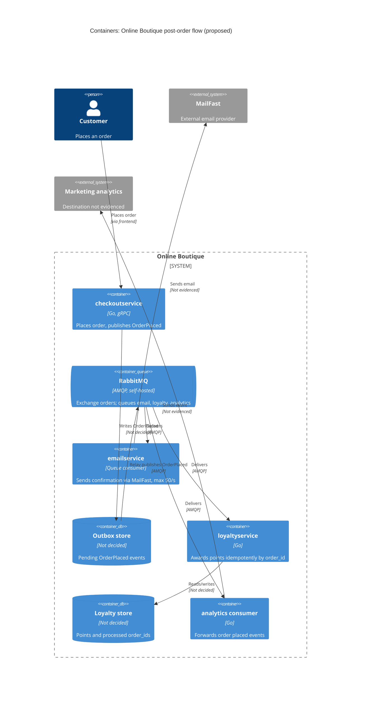

# ADR-0002: Publish an `OrderPlaced` event to RabbitMQ for post-order actions

- **Status:** Proposed
- **Date:** 2026-10-23
- **Deciders:** บริพัตร อรัญยกานนท์

## Context and problem

Requirement R-12 (`docs/scenario.md`) กำหนดว่าหลังสั่งซื้อสำเร็จ ระบบต้อง (1) ส่งอีเมลยืนยันผ่าน **MailFast** แทน logic จำลองของ `emailservice` (2) ให้ loyalty points ผ่าน `loyaltyservice` ตัวใหม่ (3) บันทึก analytics event "order placed" และ marketing คาดว่าจะมี post-order action เพิ่มอีกปีหน้า (SMS, fraud scoring, recommendations update)

**สภาพปัจจุบัน (จากโค้ด):**

- `checkoutservice.PlaceOrder` เรียก `paymentservice` → `shippingservice` → `cartservice.EmptyCart` → `emailservice` ตามลำดับแบบ synchronous gRPC (`system/online-boutique/src/checkoutservice/main.go` บรรทัด 252, 258, 263, 273)
- ถ้าส่งอีเมลล้มเหลว จะแค่ `log.Warnf` และคำสั่งซื้อยังสำเร็จ (`main.go` บรรทัด 273–277)
- `checkoutservice` ผูกกับ downstream ทุกตัวผ่าน env var + gRPC connection ที่ตั้งตอนเริ่ม (`mustMapEnv` / `mustConnGRPC`, `main.go` บรรทัด 111–123) ถ้าเพิ่ม action ใหม่แบบเดิม ต้องแก้ struct `checkoutService`, `main()` และ `PlaceOrder` ทุกครั้ง
- order ID สร้างด้วย `uuid.NewUUID()` (`main.go` บรรทัด 233) จึงใช้เป็น idempotency key ได้
- ใน `main.go` ไม่มีการใช้ database หรือ message broker ใดๆ เลย

**ตัวเลขที่สำคัญ (`docs/scenario.md`):**

| เรื่อง                   | ค่า                                                                                       | ผลต่อการตัดสินใจ                                                                                      |
| ------------------------ | ----------------------------------------------------------------------------------------- | ----------------------------------------------------------------------------------------------------- |
| Latency ของ `PlaceOrder` | p95 ≤ 500 ms (ปัจจุบันประมาณ 300 ms)                                                      | เหลือ headroom ประมาณ 200 ms เท่านั้น                                                                 |
| MailFast                 | p95 1.5 s, p99 8 s, fail ประมาณ 0.5 %, rate limit 50 emails/s                             | เรียกแบบ synchronous จะทำให้ p95 เกิน 500 ms แน่นอน                                                   |
| Peak load                | 200 orders/s ช่วง 11.11                                                                   | มากกว่า rate limit ของ MailFast 4 เท่า → อีเมลค้างเพิ่มประมาณ 150 ฉบับ/วินาที ช่วง peak ต้องมี buffer |
| Loyalty points           | ภายใน 1 นาที และ exactly once                                                             | ต้องมี retry + dedup ฝั่งผู้รับ                                                                       |
| Availability             | order ห้ามล้มเพราะ email, loyalty หรือ analytics ล่ม                                      | post-order action ต้องแยกออกจาก critical path                                                         |
| Team / Ops               | 4 devs ถนัด Go + gRPC, 2 คนเคยใช้ RabbitMQ; รันบน Kubernetes; ชอบ open-source self-hosted | เอียงไปทาง broker ที่ self-host ได้และทีมคุ้นเคย                                                      |

**ปัญหา:** จะเชื่อม `checkoutservice` กับ post-order action ทั้งสามอย่าง (และที่จะเพิ่มขึ้นอีก) อย่างไร ให้ checkout ยังเร็วและไม่ล้ม ส่วน loyalty points ยังได้ครบภายใน 1 นาทีโดยไม่ซ้ำ

## Decision drivers

1. **Availability:** order ต้องไม่ล้มเพราะ email, loyalty หรือ analytics ล่ม
2. **Performance:** p95 ของ `PlaceOrder` ≤ 500 ms ที่ 200 orders/s
3. **Reliability / correctness:** loyalty points ภายใน 1 นาที และ exactly once; อีเมลต้องไม่หายแม้ MailFast fail 0.5 % หรือติด rate limit 50/s
4. **Modifiability:** เพิ่ม post-order action ใหม่ (SMS, fraud scoring, recommendations) ได้โดยไม่ต้องแก้ `checkoutservice`
5. **Cost / operability:** open-source, self-hosted บน Kubernetes; ทีมเล็ก 4 คน ใช้ทักษะที่มีอยู่ (Go, gRPC, RabbitMQ)

## Considered options

1. **Synchronous gRPC เพิ่มใน `PlaceOrder`** — เรียก MailFast (ผ่าน `emailservice`), `loyaltyservice` และ analytics ต่อท้าย call ปัจจุบัน
2. **Asynchronous ภายใน process** — `PlaceOrder` ตอบลูกค้าทันที แล้วยิง goroutine ไปเรียกแต่ละ action พร้อม retry ในหน่วยความจำของ `checkoutservice`
3. **Publish event `OrderPlaced` ไปยัง RabbitMQ (self-hosted)** — fanout/topic exchange แยก queue ให้ consumer แต่ละตัว
4. **Publish event `OrderPlaced` ไปยัง Apache Kafka (self-hosted)** — topic เดียว แต่ละ action เป็น consumer group

### Pros and cons of the options

| Option                  | Pros                                                                                                                                                                                                                                                                                                     | Cons                                                                                                                                                                                                                                          |
| ----------------------- | -------------------------------------------------------------------------------------------------------------------------------------------------------------------------------------------------------------------------------------------------------------------------------------------------------- | --------------------------------------------------------------------------------------------------------------------------------------------------------------------------------------------------------------------------------------------- |
| 1. Sync gRPC            | เรียบง่าย ตรงกับสไตล์โค้ดเดิม (`main.go` บรรทัด 379–384); ไม่มี component ใหม่; รู้ผลทันที                                                                                                                                                                                                               | MailFast p95 1.5 s ทำให้ `PlaceOrder` เกิน 500 ms แน่นอน; ติด rate limit 50/s ที่ peak 200/s; ต้องแก้ `checkoutService` struct/`main()` ทุกครั้งที่มี action ใหม่ (`main.go` บรรทัด 66–86, 111–123); ไม่มี retry → อีเมล/points หายเมื่อ fail |
| 2. Goroutine ใน process | latency ต่ำ; ไม่มี infrastructure ใหม่                                                                                                                                                                                                                                                                   | งานค้างอยู่ใน memory หายเมื่อ pod restart/scale-down → ไม่รับประกัน loyalty ภายใน 1 นาที; backlog อีเมลช่วง 11.11 อัดอยู่ใน pod; ยัง coupling เหมือนข้อ 1 (ต้องแก้ checkout เมื่อเพิ่ม action)                                                |
| 3. RabbitMQ             | แยก action ออกจาก critical path; durable queue + ack/retry + dead-letter queue รองรับ MailFast fail 0.5 %; consumer ของอีเมลคุม rate ≤ 50/s ได้ และ queue ทำหน้าที่ buffer ช่วง peak; เพิ่ม action ใหม่ = เพิ่ม queue/consumer โดยไม่แตะ checkout; open-source self-host บน Kubernetes; มี 2 devs เคยใช้ | component stateful ใหม่ต้องดูแล (cluster, quorum queue, monitoring); delivery เป็น at-least-once → ต้องทำ idempotent consumer; eventual consistency (อีเมลอาจมาช้า); event ที่ consume แล้วไม่ถูกเก็บไว้ replay                               |
| 4. Kafka                | throughput สูง; เก็บ event log ไว้ replay ได้ (มีประโยชน์กับ analytics/recommendations); เพิ่ม consumer group ใหม่ได้ง่าย                                                                                                                                                                                | ดูแลยากกว่าสำหรับทีม 4 คน; มี 2 คนเคยใช้ RabbitMQ; 200 orders/s ไม่ต้องการ throughput ระดับ Kafka; การคุม rate ต่อ consumer และ retry/DLQ ต้องเขียนเองมากกว่า                                                                                 |

## Decision

เลือก **Option 3: publish event `OrderPlaced` ไปยัง RabbitMQ** ที่ self-host บน Kubernetes

- `PlaceOrder` เขียน event ลงตาราง outbox และให้ relay เป็นตัว publish ไปยัง exchange `orders` **แทน** การเรียก `sendOrderConfirmation` (`main.go` บรรทัด 273) หลัง payment และ shipping สำเร็จ ถ้าเขียน outbox ไม่สำเร็จ ให้ log แต่ **ไม่ทำให้ order ล้ม** (รักษาพฤติกรรมเดิมที่ `main.go` บรรทัด 274)
- แต่ละ action มี durable queue ของตัวเอง bind กับ exchange:
  - `email` queue → `emailservice` (ปรับเป็น consumer) เรียก MailFast โดย limit ≤ 50 emails/s, retry แบบ backoff, ส่งเข้า dead-letter queue เมื่อ retry หมด
  - `loyalty` queue → `loyaltyservice` (Go) award points แบบ idempotent: เก็บ `order_id` ที่ประมวลผลแล้วด้วย unique constraint ใน store ของตัวเอง ack หลังบันทึกสำเร็จเท่านั้น → at-least-once delivery + dedup = effectively exactly once
  - `analytics` queue → consumer ที่ส่ง event ไปยังระบบ analytics ของ marketing
- ลบ `EMAIL_SERVICE_ADDR` / `emailSvcConn` ออกจาก `checkoutservice` (`main.go` บรรทัด 81–82, 115, 122) แทนด้วย address ของ RabbitMQ เพียงตัวเดียว และ data store สำหรับ outbox
- action ในอนาคต (SMS, fraud scoring, recommendations) แค่เพิ่ม queue + consumer ใหม่

**เหตุผล:** เป็นตัวเลือกเดียวที่ผ่าน driver 1–3 พร้อมกัน (เอา MailFast ออกจาก critical path, มี buffer สำหรับ 200 vs 50/s, durable + retry สำหรับ loyalty) และผ่าน driver 4 (เพิ่ม action โดยไม่แก้ checkout) ส่วน driver 5 RabbitMQ ดีกว่า Kafka เพราะทีมมีประสบการณ์และ load ไม่สูงพอจะคุ้มกับความซับซ้อนของ Kafka

## Consequences

- **Positive:** latency ของ MailFast (p95 1.5 s, p99 8 s) ไม่อยู่ใน `PlaceOrder` อีกต่อไป และยังตัด call ไป `emailservice` ออก → p95 ควรอยู่ใต้ 500 ms ได้ **[Inferred]** latency ของการ publish พร้อม confirm ยังไม่มีตัวเลขใน context (quality attribute: performance)
- **Positive:** email, loyalty, analytics ล่มได้โดยไม่กระทบ order; message รออยู่ใน queue จนกว่า consumer จะกลับมา (quality attribute: availability)
- **Positive:** queue ดูดซับส่วนต่าง 200 orders/s vs 50 emails/s ช่วง 11.11 และ retry/DLQ รองรับ MailFast fail 0.5 % (quality attribute: reliability, scalability)
- **Positive:** เพิ่ม post-order action ใหม่โดยไม่แก้หรือ redeploy `checkoutservice` (quality attribute: modifiability)
- **Positive:** open-source, self-host บน Kubernetes ตามนโยบาย (quality attribute: cost, portability)
- **Negative:** RabbitMQ เป็น component stateful ใหม่ ทีม 4 คนต้องดูแล upgrade, storage, monitoring (quality attribute: operability, cost)
- **Negative:** อีเมลยืนยันมาช้าลงช่วง peak: ถ้า peak 200 orders/s ยาว T วินาที backlog จะประมาณ 150 × T ฉบับ และใช้เวลาระบายประมาณ 3T วินาทีหลัง peak (คำนวณจาก 150/50) (quality attribute: performance จากมุมมองลูกค้า)
- **Negative:** ระบบกลายเป็น eventually consistent และ trace ข้าม async boundary ยากขึ้น ต้องส่ง trace context ใน message header (ปัจจุบันใช้ OpenTelemetry propagator ที่ `main.go` บรรทัด 134–137) (quality attribute: testability, observability)
- **Negative:** มี data store ใหม่ที่ทีมต้องดูแล และเพิ่ม latency ของ `PlaceOrder` (quality attribute: operability, performance)
- **Risks and mitigations:**
  - _Event หายถ้า RabbitMQ ล่มตอน publish_ (order สำเร็จแต่ไม่มีอีเมล/points) — `checkoutservice` เลือกใช้ outbox → mitigate ด้วย publisher confirms + retry สั้นๆ, RabbitMQ แบบ cluster + quorum queue, alert เมื่อ publish fail; outbox + relay จะ retry จนกว่าจะ publish สำเร็จ
  - _Loyalty ซ้ำ_ จาก redelivery หรือ publish ซ้ำ — dedup ด้วย `order_id` (มาจาก `uuid.NewUUID()`, `main.go` บรรทัด 233) ใน `loyaltyservice`
  - _Loyalty เกิน 1 นาที_ ถ้า `loyaltyservice` ล่มนานกว่า 1 นาที — ใช้ ≥ 2 replicas เพราะถ้ามี replica เดียวแล้วล่มนานเกิน 1 นาที แต้มจะเข้าไม่ทัน การมีอย่างน้อย 2 replicas ทำให้อีกตัวรับงานต่อได้ทันที, alert เมื่อ queue age > 30 s
  - _อีเมลซ้ำ_ ถ้า MailFast ส่งสำเร็จแต่ ack ไม่ทัน — Not evidenced ว่า MailFast รองรับ idempotency key หรือไม่ (ดู Open questions)
  - _Poison message_ — dead-letter queue + dashboard

## Validation

- Load test `PlaceOrder` ที่ 200 orders/s (เช่นด้วย Locust `loadgenerator` ตามแนวทางของ ADR-0001) และตรวจว่า p95 ≤ 500 ms
- ระหว่าง load test ปิด `emailservice`, `loyaltyservice` และ analytics consumer ทีละตัว: อัตรา order ที่ล้มต้องเป็น 0
- วัด end-to-end lag ของ `loyalty` queue: p99 < 60 s ที่ peak; reconcile จำนวน order กับ points ต้องตรง 1:1 (ไม่มีซ้ำ ไม่มีขาด)
- Fault injection: kill pod ของ `loyaltyservice` ระหว่างประมวลผล แล้วตรวจว่าไม่มี points ซ้ำ
- วัดอัตราการเรียก MailFast ≤ 50/s และ backlog ของ `email` queue ระบายหมดในเวลาที่ marketing ยอมรับ
- Review ADR นี้อีกครั้งก่อนเพิ่ม post-order action ตัวแรกของปีหน้า

## Open questions

- อีเมลยืนยันช้าได้สูงสุดเท่าไรจึงยอมรับได้? และช่วง peak 200 orders/s ยาวนานแค่ไหน? (จำเป็นต่อการกำหนดขนาด queue และเวลาระบาย backlog) — Not evidenced in the provided files
- outbox จะใช้ data store ตัวไหน
- MailFast ใช้ protocol/API แบบไหน และรองรับ idempotency key เพื่อกันอีเมลซ้ำหรือไม่?
- ระบบ analytics ของ marketing คืออะไร และต้องการ retention/replay ของ event หรือไม่? (ถ้าต้องการ replay ระยะยาว อาจต้องพิจารณา Kafka หรือ RabbitMQ Streams ใหม่)
- `loyaltyservice` จะใช้ data store อะไร (ต้องรองรับ unique constraint บน `order_id`)?
- `emailservice` เขียนด้วยภาษาอะไร และจะปรับเป็น consumer หรือสร้าง consumer ใหม่ใน Go แทน? — ไม่มีโค้ดของ `emailservice` ใน context
- มี SLO สำหรับ latency ของ publish ไปยัง RabbitMQ หรือ budget ด้าน infrastructure (จำนวน node/storage สำหรับ RabbitMQ cluster) หรือไม่?
- fraud scoring ในปีหน้าอาจต้อง **บล็อก** order ก่อนยืนยัน ซึ่งไม่เข้ากับ event หลังสั่งซื้อ — ต้องยืนยันกับ marketing ว่าเป็น post-order จริงหรือไม่
