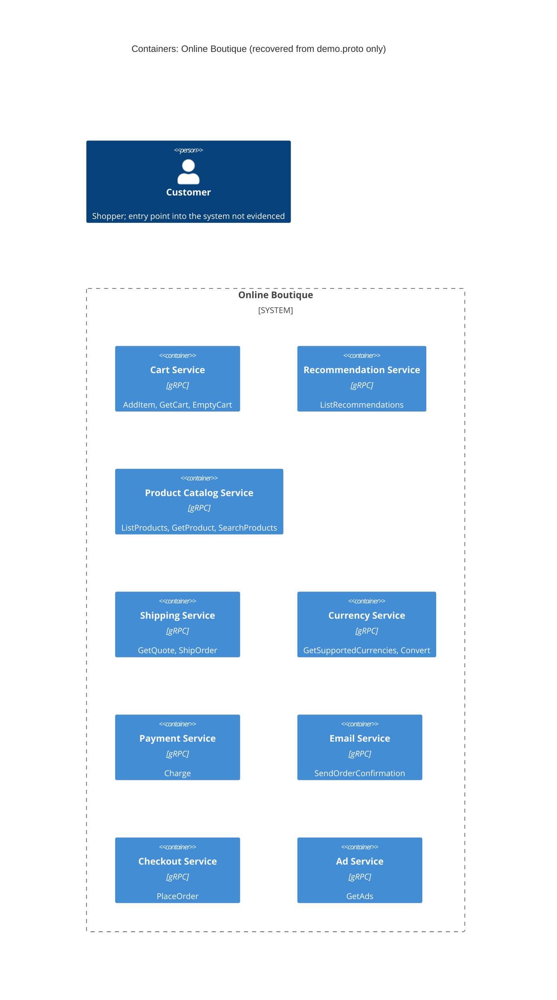

# Task 1A: Recovered architecture (C4 container level)

## 1. Agent

Claude Code (Anthropic), model Claude Opus 5.5 (`claude-opus-5-5`).

## 2. Files read

- `prompts/1-recover-architecture.md` (task instructions)
- `system/online-boutique/protos/demo.proto` (the only evidence file)

## 3. Containers table

All containers below come from `service` definitions in the proto (package `hipstershop`, line 17). The proto defines **interfaces only**. It shows that each service exposes gRPC/Protocol Buffers, but not which language implements it.

| Container | Technology / language | Responsibility | Evidence |
|---|---|---|---|
| Cart Service | gRPC service (proto3); language not evidenced | Add items to a user's cart, get the cart, empty the cart | `system/online-boutique/protos/demo.proto` (`service CartService`, lines 23–27) |
| Recommendation Service | gRPC service (proto3); language not evidenced | Return recommended product IDs for a user and a list of products | `system/online-boutique/protos/demo.proto` (`service RecommendationService`, lines 56–58) |
| Product Catalog Service | gRPC service (proto3); language not evidenced | List products, get one product, search products | `system/online-boutique/protos/demo.proto` (`service ProductCatalogService`, lines 71–75) |
| Shipping Service | gRPC service (proto3); language not evidenced | Quote shipping cost for an address and items; ship an order and return a tracking ID | `system/online-boutique/protos/demo.proto` (`service ShippingService`, lines 107–110) |
| Currency Service | gRPC service (proto3); language not evidenced | List supported currencies; convert `Money` between ISO 4217 currencies | `system/online-boutique/protos/demo.proto` (`service CurrencyService`, lines 140–143) |
| Payment Service | gRPC service (proto3); language not evidenced | Charge a credit card and return a transaction ID | `system/online-boutique/protos/demo.proto` (`service PaymentService`, lines 177–179) |
| Email Service | gRPC service (proto3); language not evidenced | Send an order confirmation to an email address | `system/online-boutique/protos/demo.proto` (`service EmailService`, lines 199–201) |
| Checkout Service | gRPC service (proto3); language not evidenced | Place an order (user, currency, address, email, card) and return an `OrderResult` | `system/online-boutique/protos/demo.proto` (`service CheckoutService`, lines 224–226) |
| Ad Service | gRPC service (proto3); language not evidenced | Return ads (text + redirect URL) for a set of context keywords | `system/online-boutique/protos/demo.proto` (`service AdService`, lines 243–245) |

Data stores: **Not evidenced in the provided files.** No data store is declared in the proto.

## 4. Dependencies table

A `.proto` file declares what each service **offers**. It does not declare who **calls** whom, so no caller → callee dependency can be proven from this evidence.

| Caller → callee | Protocol | Evidence |
|---|---|---|
| None evidenced | n/a | Not evidenced in the provided files (`demo.proto` contains no client relationships) |

Candidate dependencies suggested by shared message types are listed under **Gaps**, not here.

## 5. Mermaid diagram

The diagram matches the tables: nine containers and no `Rel`, because no dependency is evidenced. `Person` is included because the diagram format requires it. How the customer reaches the system is not evidenced, so it has no `Rel` either.

## 6. Gaps

| Gap | Why it can't be settled from `demo.proto` | File that would settle it |
|---|---|---|
| Any caller → callee dependency | The proto defines servers only, not clients | Kubernetes manifests (`system/online-boutique/kubernetes-manifests/*.yaml`, `*_SERVICE_ADDR` env vars) or each service's source code (gRPC client stubs) |
| **[Inferred]** Checkout Service calls Cart, Product Catalog, Currency, Shipping, Payment and Email | `PlaceOrderRequest` carries `CreditCardInfo` (used by `ChargeRequest`) and `email` (used by `SendOrderConfirmationRequest`). `OrderResult` carries `shipping_tracking_id` (from `ShipOrderResponse`) and `shipping_cost`. `PlaceOrderRequest` has only `user_id`, so items probably come from the cart. All of this comes from message shapes, not from calls | `system/online-boutique/kubernetes-manifests/checkoutservice.yaml`, checkout service source |
| **[Inferred]** Recommendation Service calls Product Catalog Service | `ListRecommendationsRequest` takes `product_ids`, which suggests it needs the catalog | `system/online-boutique/kubernetes-manifests/recommendationservice.yaml`, recommendation service source |
| A user-facing frontend / web UI and how the customer reaches the system | No HTTP/web service is defined in the proto, and none of the RPCs is shaped like a UI | Kubernetes manifests (a frontend Deployment/Service, LoadBalancer), `system/online-boutique/src/` |
| Implementation language of each service | Only `option go_package` (line 19) appears. It configures Go code generation and says nothing about each service's own language | Each service's source folder or Dockerfile under `system/online-boutique/src/` |
| Data stores (e.g. where carts are kept) | **[Inferred]** `CartService` keeps per-`user_id` state between calls, so some storage probably exists, but none is named | `system/online-boutique/kubernetes-manifests/cartservice.yaml` and any data-store manifest (e.g. a cache/database Deployment) |
| External systems (real payment gateway, email provider) | `Charge` and `SendOrderConfirmation` may be internal or may call out. Not evidenced | Payment and email service source code |
| Ports, sync vs. async, message brokers | Only unary RPCs are declared. No queues or ports appear | Kubernetes manifests, service source code |
