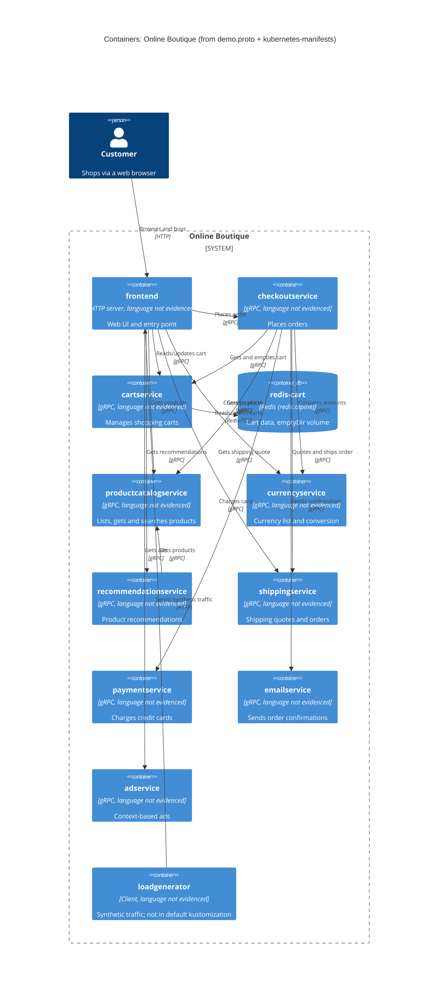

# Task 1 — Recovered architecture (run B)

## 1. Agent

- Product: Claude Code (VS Code extension)
- Model: Claude Opus 5.5 (`claude-opus-5-5`)

## 2. Files read

Evidence:

- `system/online-boutique/protos/demo.proto`
- `system/online-boutique/kubernetes-manifests/README.md`
- `system/online-boutique/kubernetes-manifests/kustomization.yaml`
- `system/online-boutique/kubernetes-manifests/adservice.yaml`
- `system/online-boutique/kubernetes-manifests/cartservice.yaml`
- `system/online-boutique/kubernetes-manifests/checkoutservice.yaml`
- `system/online-boutique/kubernetes-manifests/currencyservice.yaml`
- `system/online-boutique/kubernetes-manifests/emailservice.yaml`
- `system/online-boutique/kubernetes-manifests/frontend.yaml`
- `system/online-boutique/kubernetes-manifests/loadgenerator.yaml`
- `system/online-boutique/kubernetes-manifests/paymentservice.yaml`
- `system/online-boutique/kubernetes-manifests/productcatalogservice.yaml`
- `system/online-boutique/kubernetes-manifests/recommendationservice.yaml`
- `system/online-boutique/kubernetes-manifests/shippingservice.yaml`

Task instructions: `prompts/1-recover-architecture.md` (plus `AGENTS.md` / `CLAUDE.md`, which were loaded automatically).

## 3. Containers table

The implementation language of the services is **not evidenced** in these files. The manifests only give placeholder image names (e.g. `image: frontend`), and `README.md` says real tags are inserted by `skaffold`. The "Technology" column therefore lists only what the files do show: the protocol each container serves and its port.

| Container | Technology / language | Responsibility | Evidence |
|---|---|---|---|
| `frontend` | Language not evidenced; HTTP server on port 8080, exposed via `LoadBalancer` Service `frontend-external` on port 80 | Web UI / entry point for shoppers; calls the backend services | `kubernetes-manifests/frontend.yaml` (Service `frontend-external`, `type: LoadBalancer`, port name `http`; `httpGet` probes on `/_healthz`) |
| `cartservice` | Language not evidenced; gRPC server on port 7070 | Stores the user's cart: `AddItem`, `GetCart`, `EmptyCart` | `protos/demo.proto` (`service CartService`); `kubernetes-manifests/cartservice.yaml` (Service port name `grpc`, 7070) |
| `redis-cart` | Redis (`image: redis:alpine`), port 6379 | Data store behind `cartservice`; data on an `emptyDir` volume (not persisted across pod restarts) | `kubernetes-manifests/cartservice.yaml` (Deployment `redis-cart`, `volumes: redis-data emptyDir`) |
| `productcatalogservice` | Language not evidenced; gRPC on port 3550 | Product list, lookup, search: `ListProducts`, `GetProduct`, `SearchProducts` | `protos/demo.proto` (`service ProductCatalogService`); `kubernetes-manifests/productcatalogservice.yaml` |
| `currencyservice` | Language not evidenced; gRPC on port 7000 | Supported currencies and conversion: `GetSupportedCurrencies`, `Convert` | `protos/demo.proto` (`service CurrencyService`); `kubernetes-manifests/currencyservice.yaml` |
| `recommendationservice` | Language not evidenced; gRPC on port 8080 | Recommends products: `ListRecommendations` | `protos/demo.proto` (`service RecommendationService`); `kubernetes-manifests/recommendationservice.yaml` |
| `shippingservice` | Language not evidenced; gRPC on port 50051 | Shipping quotes and shipping orders: `GetQuote`, `ShipOrder` | `protos/demo.proto` (`service ShippingService`); `kubernetes-manifests/shippingservice.yaml` |
| `checkoutservice` | Language not evidenced; gRPC on port 5050 | Places orders: `PlaceOrder` (orchestrates cart, catalog, currency, shipping, payment, email) | `protos/demo.proto` (`service CheckoutService`); `kubernetes-manifests/checkoutservice.yaml` |
| `paymentservice` | Language not evidenced; gRPC on port 50051 | Charges a credit card: `Charge` | `protos/demo.proto` (`service PaymentService`); `kubernetes-manifests/paymentservice.yaml` |
| `emailservice` | Language not evidenced; gRPC (Service port 5000 → container port 8080) | Sends order confirmation: `SendOrderConfirmation` | `protos/demo.proto` (`service EmailService`); `kubernetes-manifests/emailservice.yaml` |
| `adservice` | Language not evidenced; gRPC on port 9555 | Context-based ads: `GetAds` | `protos/demo.proto` (`service AdService`); `kubernetes-manifests/adservice.yaml` |
| `loadgenerator` | Language not evidenced; client only (no Service) | Generates synthetic user traffic against the frontend (`USERS=10`, `RATE=1`). Not part of the default deployment: it is commented out in `kustomization.yaml` | `kubernetes-manifests/loadgenerator.yaml`; `kubernetes-manifests/kustomization.yaml` (`# - loadgenerator.yaml`) |

## 4. Dependencies table

Protocol evidence for gRPC: every callee's Kubernetes Service names its port `grpc` and uses `grpc` readiness/liveness probes, and its API is a `service` in `demo.proto`. The only exception is `redis-cart`, whose port is named `tcp-redis`.

| Caller → Callee | Protocol | Evidence |
|---|---|---|
| Customer → `frontend` | HTTP | `kubernetes-manifests/frontend.yaml` (Service `frontend-external`, `type: LoadBalancer`, port 80 named `http`) |
| `loadgenerator` → `frontend` | HTTP | `kubernetes-manifests/loadgenerator.yaml` (`FRONTEND_ADDR=frontend:80`; init container `wget http://${FRONTEND_ADDR}`) |
| `frontend` → `productcatalogservice` | gRPC | `kubernetes-manifests/frontend.yaml` (`PRODUCT_CATALOG_SERVICE_ADDR=productcatalogservice:3550`) |
| `frontend` → `currencyservice` | gRPC | `kubernetes-manifests/frontend.yaml` (`CURRENCY_SERVICE_ADDR=currencyservice:7000`) |
| `frontend` → `cartservice` | gRPC | `kubernetes-manifests/frontend.yaml` (`CART_SERVICE_ADDR=cartservice:7070`) |
| `frontend` → `recommendationservice` | gRPC | `kubernetes-manifests/frontend.yaml` (`RECOMMENDATION_SERVICE_ADDR=recommendationservice:8080`) |
| `frontend` → `shippingservice` | gRPC | `kubernetes-manifests/frontend.yaml` (`SHIPPING_SERVICE_ADDR=shippingservice:50051`) |
| `frontend` → `checkoutservice` | gRPC | `kubernetes-manifests/frontend.yaml` (`CHECKOUT_SERVICE_ADDR=checkoutservice:5050`) |
| `frontend` → `adservice` | gRPC | `kubernetes-manifests/frontend.yaml` (`AD_SERVICE_ADDR=adservice:9555`) |
| `checkoutservice` → `productcatalogservice` | gRPC | `kubernetes-manifests/checkoutservice.yaml` (`PRODUCT_CATALOG_SERVICE_ADDR=productcatalogservice:3550`) |
| `checkoutservice` → `shippingservice` | gRPC | `kubernetes-manifests/checkoutservice.yaml` (`SHIPPING_SERVICE_ADDR=shippingservice:50051`) |
| `checkoutservice` → `paymentservice` | gRPC | `kubernetes-manifests/checkoutservice.yaml` (`PAYMENT_SERVICE_ADDR=paymentservice:50051`) |
| `checkoutservice` → `emailservice` | gRPC | `kubernetes-manifests/checkoutservice.yaml` (`EMAIL_SERVICE_ADDR=emailservice:5000`) |
| `checkoutservice` → `currencyservice` | gRPC | `kubernetes-manifests/checkoutservice.yaml` (`CURRENCY_SERVICE_ADDR=currencyservice:7000`) |
| `checkoutservice` → `cartservice` | gRPC | `kubernetes-manifests/checkoutservice.yaml` (`CART_SERVICE_ADDR=cartservice:7070`) |
| `recommendationservice` → `productcatalogservice` | gRPC | `kubernetes-manifests/recommendationservice.yaml` (`PRODUCT_CATALOG_SERVICE_ADDR=productcatalogservice:3550`) |
| `cartservice` → `redis-cart` | Redis protocol over TCP | `kubernetes-manifests/cartservice.yaml` (`REDIS_ADDR=redis-cart:6379`; Service `redis-cart` port name `tcp-redis`) |

## 5. Mermaid diagram

## 6. Gaps

| Gap | What the evidence shows | File that would settle it |
|---|---|---|
| Implementation language of each service | Placeholder image names only (`image: frontend`, …); `README.md` says tags come from `skaffold` | Each service's `Dockerfile` / source folder under `system/online-boutique/src/<service>/` |
| `shoppingassistantservice` | `frontend.yaml` sets `SHOPPING_ASSISTANT_SERVICE_ADDR=shoppingassistantservice:80`, but no manifest in this folder deploys it, and `kustomization.yaml` only mentions `../kustomize/components/shopping-assistant` (commented out). Left out of the diagram because it is not part of this deployment. | `system/online-boutique/kustomize/components/shopping-assistant/`; `src/frontend/` (to see if it is called only when `ENABLE_ASSISTANT` is set) |
| Optional packaging service | Only a commented-out `PACKAGING_SERVICE_URL` in `frontend.yaml` | `src/frontend/` source |
| Which RPCs each caller actually uses | `demo.proto` defines the APIs; the manifests only show *which* address each service is given, not which methods it calls. The Rel labels are inferred from the method names. **[Inferred]** | Client code in `src/frontend/`, `src/checkoutservice/`, `src/recommendationservice/` |
| External systems (real payment provider, SMTP/mail server) | No address, secret or env var for any external system in the manifests. `paymentservice` and `emailservice` show no outgoing dependency. | `src/paymentservice/`, `src/emailservice/` |
| Data store for `productcatalogservice` | No DB address or volume in its manifest; storage is not evidenced | `src/productcatalogservice/` |
| Alternative cart stores (Memorystore, Spanner, AlloyDB) | Only named as commented-out kustomize components | `system/online-boutique/kustomize/components/{memorystore,spanner,alloydb}/` |
| Whether gRPC is plaintext or TLS / service mesh | `sidecar.istio.io/rewriteAppHTTPProbers` annotation hints at Istio support, but no mesh config is in the evidence | Istio / service-mesh manifests (e.g. under `system/online-boutique/istio-manifests/`) |
| Whether `redis-cart` data survives restarts | It uses an `emptyDir` volume, so data is lost when the pod is rescheduled; whether that is intended is not documented | Project `README` / docs |
